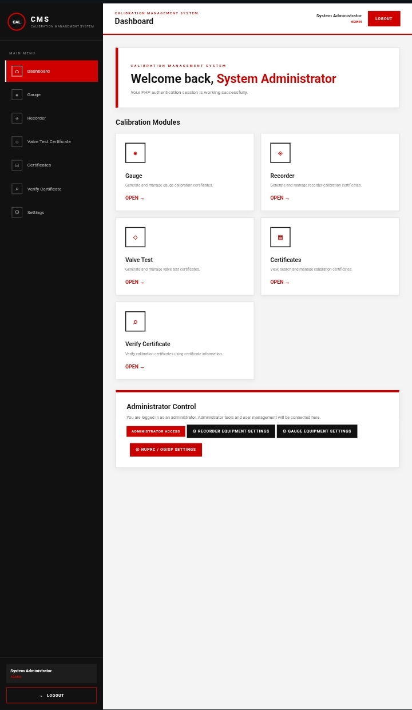
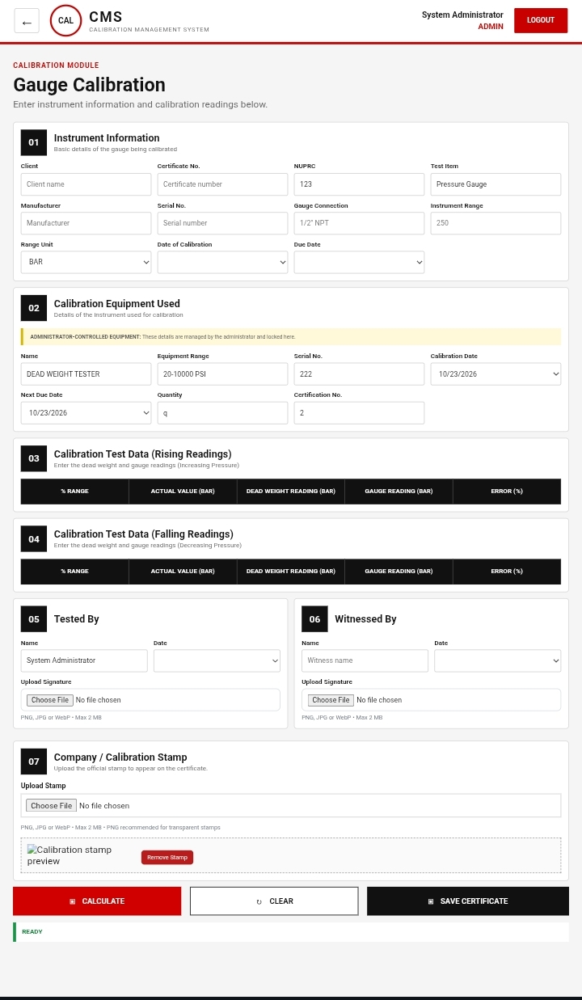
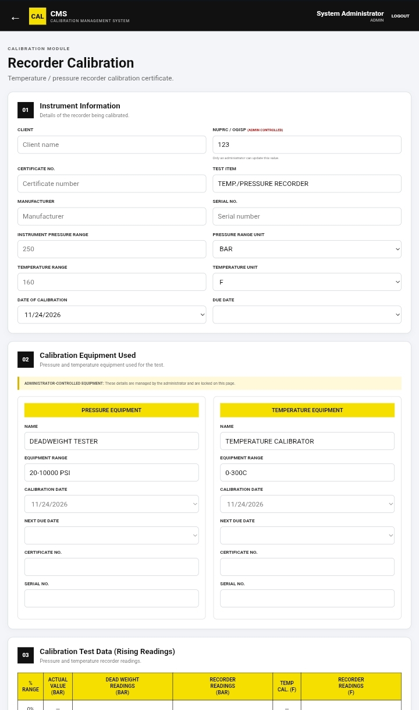
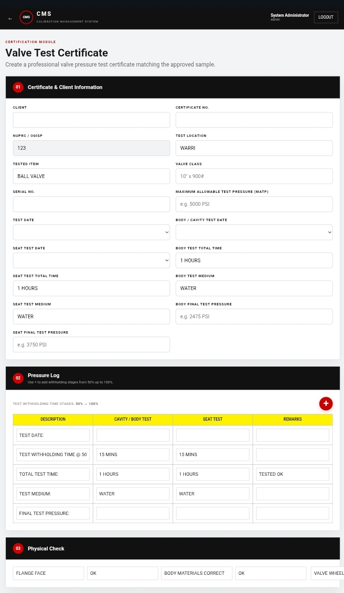
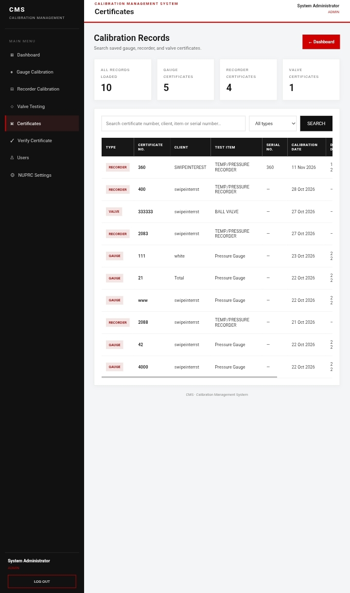

# Calibration Management System (CMS)


A web-based Calibration Management System designed to manage calibration records, equipment information, readings, and certification workflows.

## Overview

The Calibration Management System (CMS) provides a centralized platform for managing calibration activities and generating organized calibration records for industrial equipment.

The system is designed to improve record management, support calibration workflows, and make equipment certification more organized and accessible.

## Application Preview

### Dashboard



### Gauge Calibration



### Recorder Calibration



### Valve Certification



### Generated Calibration Certificate



## Key Features

- User authentication and role-based access
- Dashboard and calibration record management
- Gauge calibration management
- Recorder calibration management
- Valve certification management
- Calibration readings and test records
- Equipment settings management
- Certificate generation
- System configuration
- Database-backed record storage

## Technology Stack

- **Frontend:** HTML, CSS, JavaScript
- **Backend:** PHP
- **Database:** MySQL
- **Hosting:** InfinityFree

## Database Documentation

The database documentation is available in the [`database/`](database/) directory.

| File | Description |
|---|---|
| [README.md](database/README.md) | Database documentation |
| [schema.sql](database/schema.sql) | Database structure |
| [ERD.md](database/ERD.md) | Entity Relationship Diagram |

The database schema contains 13 tables covering users, calibration records, readings, equipment settings, and system configuration.

## Installation

1. Clone or download this repository.
2. Set up a PHP-compatible web server.
3. Create a MySQL database.
4. Import `database/schema.sql` using phpMyAdmin or the MySQL command line.
5. Configure your database connection using `config/database.example.php` as a reference.
6. Place the project in your web server directory.
7. Open the application in your browser.

**Security note:** Never publish your real database credentials. Keep private configuration files and passwords out of version control.

## Project Structure

```text
calibration-management-system/
├── auth/
├── config/
│   └── database.example.php
├── database/
│   ├── README.md
│   ├── schema.sql
│   └── ERD.md
├── public/
├── index.php
└── README.md
```

*Note: The structure above highlights key project documentation and example locations. Actual folders and files may vary.*

## Live Demo

[Open Calibration Management System](https://calibration.site.je/)

## Developer

**WHITEMAN HALLELUYAH**

Full-Stack Developer | Web & App Developer | Graphic Designer

- GitHub: [IDMan240](https://github.com/IDMan240)
- Portfolio: [hallwhiteman.page.gd](https://hallwhiteman.page.gd/)
- Email: [Email me](mailto:hallwhiteman@gmail.com)

## License

This project is available for review and learning. Please contact the developer for permission before redistributing or using it commercially.

