# Entity Relationship Diagram (ERD)

## Calibration Management System

This diagram illustrates the database tables and their explicitly defined relationships.

```mermaid
erDiagram

    RECORDER_CALIBRATIONS {
        int id PK
        varchar certificate_no
        varchar client
        int created_by
    }

    RECORDER_CALIBRATION_READINGS {
        bigint id PK
        int calibration_id FK
        enum reading_type
        decimal actual_value
        decimal recorder_reading
    }

    VALVE_CERTIFICATES {
        int id PK
        varchar certificate_no
        varchar client
        int created_by
    }

    VALVE_PHYSICAL_CHECKS {
        bigint id PK
        int valve_id FK
        varchar check_left
        varchar result_left
        varchar check_right
        varchar result_right
    }

    VALVE_PRESSURE_LOG {
        bigint id PK
        int valve_id FK
        varchar description
        varchar cavity_body_test
        varchar seat_test
    }

    GAUGE_CALIBRATIONS {
        int id PK
        varchar certificate_no
        varchar client
        int created_by
    }

    GAUGE_CALIBRATION_READINGS {
        int id PK
        int calibration_id
        varchar reading_type
        decimal actual_value
        decimal gauge_reading
    }

    USERS {
        int id PK
        varchar username
        varchar Password
        varchar full_name
        enum role
    }

    GAUGE_EQUIPMENT_SETTINGS {
        int id PK
        varchar equipment_name
        varchar equipment_serial
    }

    RECORDER_EQUIPMENT_SETTINGS {
        int id PK
        enum equipment_type
        varchar name
        varchar serial_no
    }

    VALVE_EQUIPMENT_SETTINGS {
        int id PK
        varchar equipment_name
        varchar equipment_range
    }

    NUPRC_SETTINGS {
        int id PK
        varchar nuprc
    }

    SYSTEM_SETTINGS {
        varchar setting_key PK
        text setting_value
    }

    RECORDER_CALIBRATIONS ||--o{ RECORDER_CALIBRATION_READINGS : "has readings"

    VALVE_CERTIFICATES ||--o{ VALVE_PHYSICAL_CHECKS : "has checks"

    VALVE_CERTIFICATES ||--o{ VALVE_PRESSURE_LOG : "has pressure logs"
```

## Database Tables

The database contains 13 tables covering:

- Gauge calibration management
- Recorder calibration management
- Valve certification management
- Calibration readings
- Equipment settings
- User management
- System configuration

## Relationship Notes

Three foreign-key relationships are explicitly enforced:

1. `recorder_calibration_readings.calibration_id` references `recorder_calibrations.id`.
2. `valve_physical_checks.valve_id` references `valve_certificates.id`.
3. `valve_pressure_log.valve_id` references `valve_certificates.id`.

The gauge readings table has an indexed `calibration_id`, but the supplied schema does not declare a foreign-key constraint for it.

Other fields such as `created_by` and `updated_by` may represent application-level links to users, but they are not enforced as foreign keys in this schema.

## Database Engine

- MySQL
- InnoDB for most tables
- MyISAM for the users table
- UTF-8 support
- 
